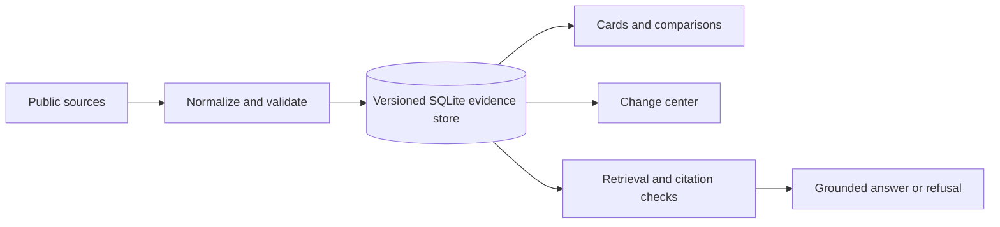

# ADC-Evidence

[](https://github.com/Petey-PKU/ADC-Evidence/actions/workflows/ci.yml)
[](https://www.python.org/)
[](https://streamlit.io/)

**ADC-Evidence is an evidence-first research workspace for antibody–drug conjugates (ADCs).** It turns public source records into traceable facts, side-by-side comparisons, change events, and citation-checked answers.

English is the primary project introduction. [中文说明](#中文说明) follows below.

> Research software · v0.6 baseline · Not for clinical, regulatory, investment, or individualized medical decisions.

## What it does

ADC-Evidence is designed for workflows that need to show **where a fact came from, when it was observed, and whether it is complete or disputed**.

- **Evidence cards** — inspect an ADC's target, payload, linker, DAR, status, sources, timestamps, history, and provenance status.
- **Structured comparison** — compare 2–10 ADCs with cell-level evidence; missing and conflicting values remain visible.
- **Change center** — review additions and field changes over the last 1, 7, or 30 days.
- **Evidence search** — search ADC profiles, PubMed records, and ClinicalTrials.gov records with SQLite FTS5/BM25 and optional dense or hybrid retrieval.
- **Grounded answers** — route structured questions to structured data, retrieve literature evidence when needed, attach `[S1]`-style citations, and refuse unsupported or unsafe requests.
- **Reproducible refresh** — keep immutable source snapshots, version facts and indexes, run quality gates, and support rollback before publication.
- **Public validation** — build an auditable dataset, run the public smoke benchmark, generate manifests, and verify the repository in CI.

The Streamlit app groups these workflows into **ADC Evidence Cards**, **ADC Comparison**, **Change Center**, **Evidence Search**, and **Evidence Q&A**.

## Architecture



The public-source layer can ingest ADC seed records, PubMed, ClinicalTrials.gov, and bounded ADCdb snapshots. Source URLs, acquisition times, raw-response hashes, facts, field evidence, conflicts, and changes are kept separate so a displayed value can be traced back to its provenance.

## Data and scope

- The v0.6 research baseline focuses on public ADC information, with HER2/TROP2 as the primary deep-validation scope.
- `data/sample/adcs.csv` provides the 10-record demo seed. `data/public/marketed_adc_catalog.csv` is maintained as a separate public catalog.
- Live ingestion is explicit and bounded; a clean demo database is not a claim of complete source coverage.
- The default answer backend is deterministic and offline. Remote model backends are optional and must be enabled locally.
- Public benchmark questions are exposed development/smoke tests. They support regression checks, not semantic gold-standard claims; the current validation status remains `not_ready_for_submission`.
- This repository must not contain private review records, raw private datasets, credentials, or `.env` files.

See [data sources and boundaries](docs/data_sources.md), [public dataset and Benchmark v1](docs/public_dataset_and_benchmark.md), and the [research cutoff](docs/research_cutoff_2026-09-18.md) for the current evidence boundary.

## Quick start

### 1. Install

Python 3.11+ is required. Docker is optional.

```bash
git clone https://github.com/Petey-PKU/ADC-Evidence.git
cd ADC-Evidence
python -m venv .venv
```

Activate the environment on Windows:

```powershell
.\.venv\Scripts\Activate.ps1
```

On macOS or Linux:

```bash
source .venv/bin/activate
```

Install the base package for the demo, or use the extras for multilingual dense retrieval and optional remote-model adapters:

```bash
# Demo only
python -m pip install --upgrade pip
python -m pip install -e .
# Or, for dense retrieval and optional remote-model adapters:
python -m pip install -e ".[rag,generation]"
```

### 2. Initialize and launch the app

```bash
python -m adc_evidence.init_db
streamlit run src/adc_evidence/app.py
```

Open <http://localhost:8501>. The demo initializes a local SQLite database at `data/processed/adc_evidence.db`.

The offline extractive backend needs no API key:

```bash
python -m adc_evidence.generation.answer \
  "What are the target, payload, and DAR of T-DXd?" \
  --backend extractive
```

### 3. Ingest public sources (optional)

```bash
python -m adc_evidence.ingestion.pipeline
```

The pipeline records source metadata and raw responses under `data/raw/<run_id>/` (ignored by Git). Skip a source when needed:

```bash
python -m adc_evidence.ingestion.pipeline --skip-adcdb
python -m adc_evidence.ingestion.pipeline --skip-trials
python -m adc_evidence.ingestion.pipeline --skip-pubmed
```

Use the guarded refresh flow for a versioned update with quality gates and rollback support:

```bash
python -m adc_evidence.refresh
```

### 4. Build and query an index

The hashing backend is useful for a dependency-light smoke test. The default backend can build a multilingual MiniLM index when the `rag` extra is installed.

```bash
python -m adc_evidence.rag.build_index --backend hashing
python -m adc_evidence.rag.retriever \
  "What is the payload release mechanism of Dato-DXd?" \
  --mode hybrid --top-k 5
```

### 5. Run checks

```bash
python -m unittest discover -s tests -v
python scripts/validate_public_benchmark.py \
  --questions data/annotations/public_benchmark_v1.jsonl \
  --manifest data/annotations/public_benchmark_v1.manifest.json \
  --catalog data/public/marketed_adc_catalog.csv
```

## Docker

Start the lightweight offline demo:

```bash
docker compose up --build
```

For the full CPU retrieval image with MiniLM support:

```bash
docker compose -f compose.yaml -f compose.full.yaml up --build
```

The default Compose configuration keeps model calls offline. To run an explicitly approved remote-model experiment, copy `.env.example` to `.env`, configure the relevant provider variables, and keep the file out of Git. See [`docs/api_configuration.md`](docs/api_configuration.md).

## Repository map

```text
src/adc_evidence/       application, data layer, ingestion, retrieval, generation
configs/                 evidence policy, entities, and research cutoff
data/sample/             public demo seed data
data/public/             public ADC catalog and audit metadata
data/annotations/        public benchmark and regression questions
scripts/                 dataset, benchmark, release, and deployment commands
docs/                    design, data, deployment, and reproducibility notes
tests/                   standard-library unittest suite
```

## Documentation

- [Product scope and user tasks](docs/v0.6_product_scope.md)
- [Data sources and collection boundaries](docs/data_sources.md)
- [Public dataset and Benchmark v1](docs/public_dataset_and_benchmark.md)
- [Retrieval design](docs/retrieval_design.md) · [Generation design](docs/generation_design.md)
- [Deployment](docs/deployment.md) · [Server deployment](docs/server_deployment.md)
- [API configuration](docs/api_configuration.md)
- [System design](docs/system_design.md)

## 中文说明

ADC-Evidence 是一个面向抗体药物偶联物（ADC）研发信息核查的证据工作台。项目把公开来源整理为可追溯的结构化事实、ADC 对比、变化事件和带引用的证据回答，重点记录每条事实的来源、时间、版本与不确定性。

### 核心能力

- **ADC 证据卡**：查看靶点、载荷、连接子、DAR、研发状态、来源、历史值和审核状态。
- **结构化比较**：一次比较 2～10 个 ADC，逐单元格展开证据；缺失和冲突不会被模型静默补齐。
- **变化中心**：筛选最近 1/7/30 天的新增记录和字段变化。
- **证据检索与问答**：在 ADC 档案、PubMed、ClinicalTrials.gov 之间检索；结构化问题优先直接查事实，文献问题才进入检索和引用校验流程。
- **可复现刷新**：保留来源快照、数据版本、索引版本和质量门禁，支持发布前回滚。

### 快速开始

环境要求为 Python 3.11+。安装并启动页面：

```bash
python -m pip install -e ".[rag,generation]"
python -m adc_evidence.init_db
streamlit run src/adc_evidence/app.py
```

浏览器打开 <http://localhost:8501>。默认使用无需 API key 的离线抽取式后端；远程模型仅用于明确批准的本地实验，配置方式见 [`docs/api_configuration.md`](docs/api_configuration.md)。也可以直接使用 `docker compose up --build` 启动离线演示。

### 研究边界

当前 v0.6 以公开 ADC 信息和 HER2/TROP2 深度验证为主。公开 Benchmark 仅用于开发和回归诊断，不是语义金标准。项目不提供诊断、处方、剂量、投资建议，也不预测未来临床或监管结果。公开仓库不包含私有复核记录、私有数据集或密钥；10 条演示 seed 与公开目录用于流程复现，不代表完整覆盖。

### 相关文档

产品范围见 [`docs/v0.6_product_scope.md`](docs/v0.6_product_scope.md)，数据范围见 [`docs/data_sources.md`](docs/data_sources.md)，公开数据集与 Benchmark 见 [`docs/public_dataset_and_benchmark.md`](docs/public_dataset_and_benchmark.md)。
